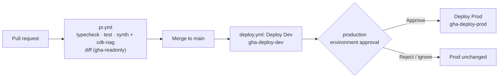

# BrewLine

在 AWS 上從零建置的 B2B 精品咖啡供應平台，用於展示 AWS Solutions Architect 的設計、資安、成本治理與維運能力。非商業作品集。
A B2B specialty-coffee supply platform built from scratch on AWS — a non-commercial AWS Solutions Architect portfolio.

- 設計文件 Design docs：[`docs/`](docs/)（從 [`docs/00-overview.md`](docs/00-overview.md) 開始；實際狀態見 [`docs/landing-zone-status.md`](docs/landing-zone-status.md)）
- 工作規則 Working rules：[`CLAUDE.md`](CLAUDE.md)

## 目前狀態 / Status

| 階段 Phase | 狀態 Status |
|---|---|
| P0 Landing Zone | ✅ 完成 |
| P1 CI/CD 骨架 | ✅ 完成：`brewline-<env>-pipeline-check` 驗證 OIDC → CDK → CloudFormation |
| P1 共用資料基礎 | 🚧 進行中：`brewline-<env>-data`（KMS CMK + DynamoDB 單表，ADR-018） |

## 程式庫結構 / Layout

```text
.
├── .github/
│   ├── workflows/pr.yml       # PR：typecheck、test、synth（cdk-nag）、唯讀 diff
│   ├── workflows/deploy.yml   # main：Dev 自動 → Prod 需核准
│   └── dependabot.yml
├── docs/                      # 設計文件 / design docs
└── infra/app/                 # CDK app（TypeScript）
    ├── bin/app.ts             # 進入點：-c env=dev|prod
    ├── lib/config.ts          # 帳號、區域（ap-east-2）
    ├── lib/aspects/           # 標籤規範、資料保護檢查 Aspect
    ├── lib/stacks/            # pipeline-check、data
    ├── scripts/               # 部署後驗證 / post-deploy checks
    └── test/                  # Jest 單元測試
```

## 本機開發 / Local development

### 前置需求 / Prerequisites

- Node.js 24 LTS（見 `.nvmrc`；`nvm use` 或 `fnm use`）
- 只有 `cdk diff` / `cdk deploy` 需要 AWS 憑證，且一律透過 IAM Identity Center（**不使用存取金鑰**）

### Synth（不需要 AWS 憑證）

```bash
cd infra/app
npm ci
npm test                         # 單元測試（含 cdk-nag 正反向測試）
npx cdk synth -c env=dev         # 產生 cdk.out/brewline-dev-pipeline-check.template.json
npx cdk synth -c env=prod
```

`-c env` 必填；漏掉或拼錯會直接失敗，避免部署到錯的帳號。cdk-nag（AwsSolutions）違規也會讓 synth 失敗。

### Diff（需要 AWS 憑證）

```bash
# 一次性設定 Identity Center 設定檔（存取入口網址在密碼管理器 / status 文件）
aws configure sso --profile brewline-dev-ro
#   SSO region: ap-east-2；account: 610935435571；role: ReadOnly；default region: ap-east-2

aws sso login --profile brewline-dev-ro
aws sts get-caller-identity --profile brewline-dev-ro    # 確認是 610935435571
npx cdk diff -c env=dev --no-change-set --profile brewline-dev-ro
```

> 正式部署請走 CI，不要從本機 `cdk deploy` 到 Prod。
> Deploy through CI; do not `cdk deploy` to Prod from a laptop.

## 部署流程 / How deployment is triggered



1. **開 PR** → `PR checks` 自動執行。Job Summary 會顯示對 Dev 的 `cdk diff`。
2. **合併到 `main`** → `Deploy` workflow 啟動，`Deploy Dev` 自動部署並驗證 SSM 參數值等於該 commit。
3. **核准 Prod** → GitHub Actions 頁面的 `Deploy Prod` 會停在 *Waiting*，按 **Review deployments → production → Approve**。不核准就不會動。

### OIDC 身分如何對應 / How OIDC identities map

| Job | `sub` claim | AWS 角色 Role |
|---|---|---|
| PR checks | `repo:chesteran321@219534971/brewline@1451431799:pull_request` | Dev `gha-readonly` |
| Deploy Dev（無 environment） | `repo:chesteran321@219534971/brewline@1451431799:ref:refs/heads/main` | Dev `gha-deploy-dev` |
| Deploy Prod（`environment: production`） | `repo:chesteran321@219534971/brewline@1451431799:environment:production` | Prod `gha-deploy-prod` |

`sub` 含 GitHub 帳號與 repo 的不可變 ID，即使 repo 改名或被同名重建也不會誤放行。

repo 裡沒有任何 AWS 金鑰；GitHub 每次執行時簽發短期 OIDC token，AWS STS 驗證 `sub` 後才給 1 小時內的臨時憑證。
No AWS keys live in this repo.

## 疑難排解 / Troubleshooting

| 症狀 Symptom | 可能原因 Likely cause |
|---|---|
| `Not authorized to perform sts:AssumeRoleWithWebIdentity` | `sub` 不符信任政策（例如 Dev job 誤加了 `environment`） |
| `explicit deny in a service control policy` 且含 `p-mljh1epv` | 預算鎖定中（`scp-budget-lockdown`），見 docs/13 RB-COST-01 |
| `explicit deny ... scp-region-restrict` | 區域不是 ap-east-2 / us-east-1 |
| `Missing or invalid context "env"` | 少了 `-c env=dev` 或 `-c env=prod` |
| `cdk diff` 提示無法扮演 deploy-role | 預期行為：PR 只有 lookup role（唯讀） |

## 授權與資料 / Data & licensing

所有咖啡廳、訂單、貨櫃資料皆為模擬產生；外部資料來源與授權見 [`docs/12-data-governance.md`](docs/12-data-governance.md)。
All café, order, and container data are synthetic.
