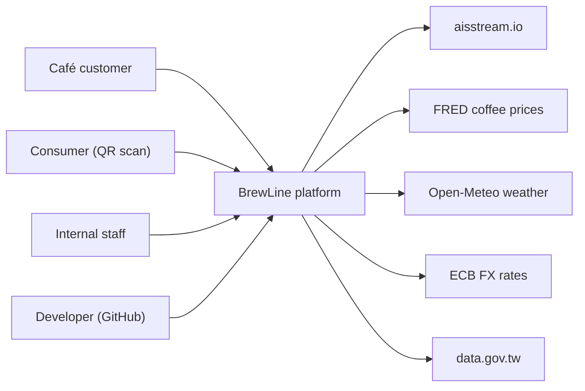
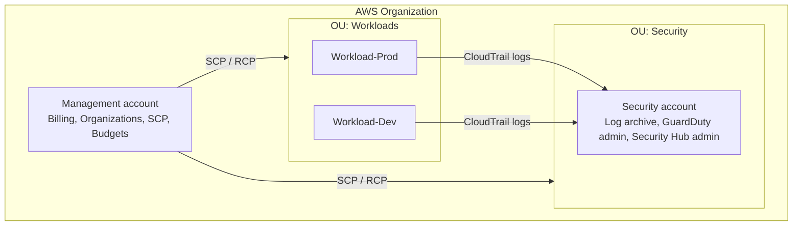
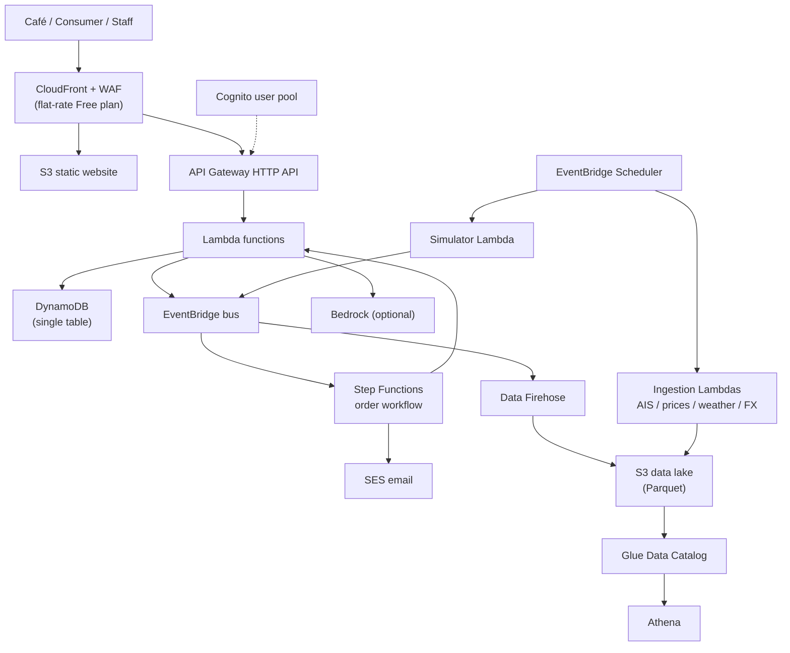
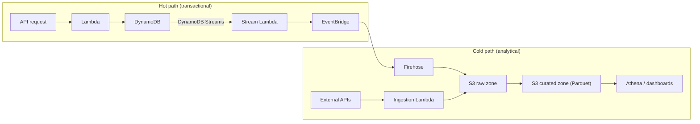
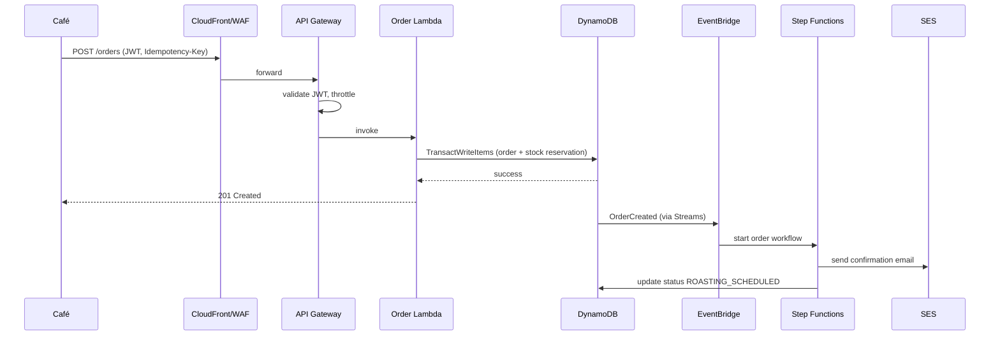

# 01 架構設計書 / Architecture Design

> 相關文件 Related：[00 總覽](00-overview.md)｜[02 部署](02-deployment.md)｜[10 資安](10-security.md)｜[11 成本](11-cost-governance.md)

---

## 1. 設計原則 / Design Principles

| 編號 ID | 原則 Principle | 說明 Rationale |
|---|---|---|
| P-01 | Serverless 優先 / Serverless first | 閒置成本趨近 0，符合 C-01 預算與 C-05 單人維運 / Near-zero idle cost |
| P-02 | 預設安全 / Secure by default | 加密、最小權限、私有儲存為預設值，而非選配 / Encryption, least privilege, private storage by default |
| P-03 | 成本即防護欄 / Cost as a guardrail | 成本控制以 SCP 與自動化強制，而非事後檢討 / Enforced via SCP and automation |
| P-04 | 一切皆程式碼 / Everything as code | 所有資源以 IaC 建立，禁止主控台手動變更 / All resources via IaC |
| P-05 | 事件驅動解耦 / Event-driven decoupling | 模組透過 EventBridge 溝通，不直接互相呼叫 / Modules talk via events |
| P-06 | 需要時才開 / On-demand expensive resources | 昂貴資源只在演練期間建立，結束即銷毀 / Ephemeral for drills only |

## 2. 系統情境圖 / System Context

## 3. 帳號結構 / Account Structure (Landing Zone)

| 帳號 Account | 用途 Purpose | 不允許 Not allowed |
|---|---|---|
| Management | 帳單、Organizations、SCP、Budgets、Identity Center | 任何工作負載 / Any workload |
| Security | 日誌封存、安全服務委派管理員 / Log archive, delegated admin | 應用程式資源 / App resources |
| Workload-Prod | 正式環境 / Production | 手動變更 / Manual changes |
| Workload-Dev | 開發與測試 / Dev & test | 正式資料 / Production data |

## 4. 邏輯架構圖 / Logical Architecture (Workload-Prod)

### 4.1 分層說明 / Layer Description

| 層 Layer | 服務 Services | 職責 Responsibility |
|---|---|---|
| 邊緣 Edge | CloudFront、WAF、Shield Standard | TLS、快取、速率限制、DDoS 防護 |
| 身分 Identity | Cognito | 咖啡廳與內部人員登入、租戶識別 |
| API | API Gateway HTTP API | 路由、JWT 驗證、限流 |
| 運算 Compute | Lambda | 業務邏輯 |
| 編排 Orchestration | Step Functions、EventBridge | 訂單流程、模組間事件 |
| 資料 Data | DynamoDB、S3、Glue、Athena | 交易資料、資料湖、分析查詢 |
| 收集 Ingestion | EventBridge Scheduler、Lambda、Firehose | 外部資料與模擬資料匯入 |
| 通知 Notification | SES、SNS | 客戶信件、維運告警 |

## 5. 資料流圖 / Data Flow

資料湖分區 / Data lake zones：

| 區 Zone | 內容 Content | 格式 Format | 保留 Retention |
|---|---|---|---|
| raw | 原始 API 回應、事件 / Raw API responses, events | JSON（gzip） | 90 天後轉 Glacier Instant Retrieval |
| curated | 清洗、去重後資料 / Cleaned, deduplicated | Parquet，依日期分區 / partitioned by date | 2 年 |
| analytics | 彙總結果 / Aggregates | Parquet | 2 年 |

## 6. 關鍵流程時序圖：下單 / Key Sequence: Place Order

## 7. 非功能需求 / Non-Functional Requirements

| 編號 ID | 類別 Category | 需求 Requirement | 目標 Target |
|---|---|---|---|
| NFR-001 | 可用性 Availability | 訂貨 API 月可用性 / Ordering API monthly availability | ≥ 99.5% |
| NFR-002 | 效能 Performance | 訂貨 API p95 延遲（暖啟動）/ p95 latency (warm) | < 500 ms |
| NFR-003 | 效能 Performance | 溯源頁首次載入 / Traceability page first load | < 2 s（4G） |
| NFR-004 | 復原 Recovery | DynamoDB RPO | ≤ 5 分鐘 / 5 min（PITR） |
| NFR-005 | 復原 Recovery | 單區 RTO / Single-region RTO | ≤ 4 小時 / 4 h（IaC 重建 / IaC redeploy） |
| NFR-006 | 安全 Security | 靜態與傳輸中資料全加密 / Encryption at rest and in transit | 100% |
| NFR-007 | 安全 Security | Security Hub FSBP 合規分數 / FSBP score | ≥ 90% |
| NFR-008 | 成本 Cost | 年度總成本 / Annual total cost | ≤ USD 300 |
| NFR-009 | 營運 Operability | 所有資源由 IaC 建立 / IaC coverage | 100% |
| NFR-010 | 可觀測性 Observability | 關鍵流程具分散式追蹤 / Distributed tracing on key flows | 100% |
| NFR-011 | 擴展性 Scalability | 不改架構可承受 100 倍流量 / 100× traffic without redesign | 設計審查驗證 / Design review |

可用性 99.5% 是刻意的取捨：單區部署、無多區主動備援，以符合預算。詳見 [ADR-004](14-adr-and-risks.md)。
99.5% is a deliberate trade-off (single region, no active-active) to fit the budget. See ADR-004.

## 8. 區域策略 / Region Strategy

| 用途 Use | 區域 Region | 理由 Reason |
|---|---|---|
| 主要工作負載 Primary workload | ap-northeast-1（Tokyo） | 服務完整、延遲低 / Full service coverage, low latency to Taiwan |
| 全域服務 Global services | us-east-1 | CloudFront 憑證、帳單指標 / ACM for CloudFront, billing metrics |
| DR 演練 DR drill | ap-southeast-1（Singapore） | 僅演練時建立 / Created only during drills |

台北區域（ap-east-2）列為評估項目，需確認服務可用性與價格後再決定，見 [ADR-009](14-adr-and-risks.md)。

## 9. 技術選型 / Technology Stack

| 項目 Item | 選擇 Choice |
|---|---|
| IaC | AWS CDK（TypeScript） |
| Lambda 語言 Runtime | Python 3.12（資料處理）、TypeScript（API） |
| CI/CD | GitHub Actions + OIDC |
| IaC 安全檢查 IaC scanning | cdk-nag、checkov |
| 前端 Frontend | 靜態 SPA（S3 + CloudFront） |
| API 規格 API spec | OpenAPI 3.1；物流事件參照 DCSA Track & Trace |
| 可觀測性 Observability | CloudWatch、X-Ray、Lambda Powertools |

## 10. 擴展路徑 / Scale-out Path（NFR-011）

| 觸發條件 Trigger | 調整 Change |
|---|---|
| 請求量超過 CloudFront Free 方案 / Exceeds Free plan | 升級 Pro 方案 / Upgrade to Pro plan |
| Lambda 冷啟動影響 p95 | Provisioned concurrency（僅尖峰時段） |
| Athena 查詢成本上升 | 預先彙總、CTAS、分區修剪 / Pre-aggregation, partition pruning |
| 需多區高可用 | DynamoDB Global Tables + Route 53 容錯移轉 |
| 長時間運算 | 改用 ECS Fargate / Move to Fargate |
