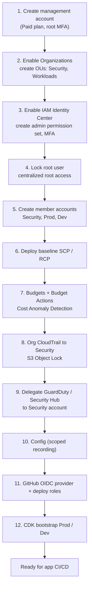
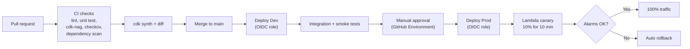

# 02 部署與環境 / Deployment & Environments

> 相關文件 Related：[01 架構](01-architecture.md)｜[10 資安](10-security.md)｜[13 維運](13-operations.md)

本專案有兩條部署流程：**一次性的 Landing Zone 建置**，以及**日常的應用程式 CI/CD**。兩者權限、頻率、風險完全不同，因此分開設計。
There are two deployment flows: a **one-time Landing Zone bootstrap** and the **routine application CI/CD**. They differ in permissions, frequency, and risk, so they are designed separately.

---

## 1. Landing Zone 建置流程 / Landing Zone Bootstrap



| 步驟 Step | 執行方式 Method | 執行身分 Identity | 驗證 Verification |
|---|---|---|---|
| 1–3 | 主控台手動 Console | Root → Identity Center admin | 登入測試 / Login test |
| 4 | 主控台 Console | Identity Center admin | 成員帳號無 root 憑證 / No member root credentials |
| 5–11 | CDK（`infra/landing-zone`） | Identity Center admin（本機 local） | `cdk diff` 無漂移 / No drift |
| 12 | `cdk bootstrap` | Identity Center admin | Bootstrap stack 存在 / exists |

**原則 Principles**
- 步驟 1–4 以外全部 IaC 化；手動步驟記錄於本文件，作為唯一例外。
  Everything except steps 1–4 is IaC; manual steps are documented here as the only exceptions.
- Landing Zone 堆疊**不進** GitHub Actions，只能由管理員本機部署，避免 CI 擁有組織層級權限。
  Landing Zone stacks are **never** deployed from CI to keep org-level permissions out of the pipeline.
- Budgets 與 SCP 必須在任何工作負載部署**之前**完成（步驟 6–7）。
  Budgets and SCPs must exist **before** any workload.

## 2. 應用程式 CI/CD 流程 / Application CI/CD



### 2.1 各階段要求 / Stage Requirements

| 階段 Stage | 必須通過 Must pass | 失敗處理 On failure |
|---|---|---|
| CI checks | 單元測試覆蓋率 ≥ 70%；cdk-nag 無 Error；checkov 無 High | 阻擋合併 / Block merge |
| cdk diff | 若出現 IAM 或安全群組變更，PR 需標記 `security-review` | 人工審查 / Manual review |
| Deploy Dev | CloudFormation 成功 | 自動回滾堆疊 / Stack rollback |
| Integration tests | API 合約測試、端到端下單流程 | 阻擋 Prod / Block prod |
| Manual approval | GitHub Environment 保護規則 | — |
| Canary | 錯誤率與 p95 告警未觸發 / No alarm | CodeDeploy 自動回滾 / Auto rollback |

### 2.2 GitHub OIDC 信任條件 / OIDC Trust Conditions

| 角色 Role | 允許的 `sub` Allowed subject | 權限範圍 Scope |
|---|---|---|
| `gha-deploy-dev` | `repo:<owner>/brewline:ref:refs/heads/main` | Dev 帳號 CDK 部署 |
| `gha-deploy-prod` | `repo:<owner>/brewline:environment:production` | Prod 帳號 CDK 部署 |
| `gha-readonly` | `repo:<owner>/brewline:pull_request` | `cdk diff` 唯讀 / read-only |

不建立任何 IAM User 或長期存取金鑰。/ No IAM users or long-lived keys.

## 3. 環境定義 / Environments

| 項目 Item | Dev | Prod |
|---|---|---|
| 帳號 Account | Workload-Dev | Workload-Prod |
| 資料 Data | 模擬資料 / Simulated only | 模擬資料 + 外部公開資料 / Simulated + public |
| GuardDuty | 開啟 On | 開啟 On |
| Security Hub | 關閉 Off | 開啟 On（FSBP） |
| Config | 每日定期記錄 Daily periodic | 連續記錄關鍵資源 Continuous, scoped |
| DynamoDB PITR | 關閉 Off | 開啟 On |
| 日誌保留 Log retention | 7 天 days | 30 天 days |
| 部署方式 Deploy trigger | 合併 main 自動 / Auto on merge | 人工核准 / Manual approval |

## 4. 程式庫結構 / Repository Structure

```text
brewline/
├── docs/                    # 本文件集 / This document set
├── infra/
│   ├── landing-zone/        # 組織層級，僅本機部署 / Org-level, local deploy only
│   └── app/                 # 應用堆疊 / Application stacks
│       ├── edge-stack.ts
│       ├── api-stack.ts
│       ├── data-stack.ts
│       ├── ingestion-stack.ts
│       └── observability-stack.ts
├── services/
│   ├── ordering/
│   ├── traceability/
│   ├── procurement/
│   ├── shipment/
│   ├── simulator/
│   └── ai/
├── frontend/
├── api/openapi.yaml
└── .github/workflows/
```

## 5. 命名規範 / Naming Convention

格式 Format：`brewline-<env>-<module>-<resource>`

| 資源 Resource | 範例 Example |
|---|---|
| Lambda | `brewline-prod-ordering-create-order` |
| DynamoDB | `brewline-prod-core`（單表 single table） |
| S3 | `brewline-prod-lake-<account-id>` |
| Step Functions | `brewline-prod-ordering-workflow` |
| SNS | `brewline-prod-ops-alerts` |

## 6. 標籤規範 / Tagging Policy

| 標籤 Tag | 必填 Required | 值 Values | 用途 Purpose |
|---|---|---|---|
| `project` | 是 Yes | `brewline` | 成本分配 / Cost allocation |
| `env` | 是 Yes | `dev`、`prod`、`drill` | 成本分配、SCP 條件 |
| `module` | 是 Yes | `ordering`、`traceability`… | 模組成本 / Per-module cost |
| `owner` | 是 Yes | `chester` | 責任歸屬 / Ownership |
| `data-class` | 資料資源 Data resources | `public`、`internal`、`pii` | 資料分級 / Data classification |
| `ttl` | 演練資源 Drill resources | ISO 日期 / ISO date | 自動清除 / Auto cleanup |

標籤由 CDK Aspect 強制套用，並由 Organizations Tag Policy 檢查。
Tags are enforced via a CDK Aspect and checked by an Organizations Tag Policy.

## 7. 演練環境 / Drill Environment

DR 演練與負載測試使用 `env=drill` 標籤，部署到 ap-southeast-1，並帶 `ttl` 標籤。排程 Lambda 每小時檢查，超過 `ttl` 的堆疊自動刪除。
Drills deploy to ap-southeast-1 with `env=drill` and a `ttl` tag; an hourly Lambda deletes expired stacks.
