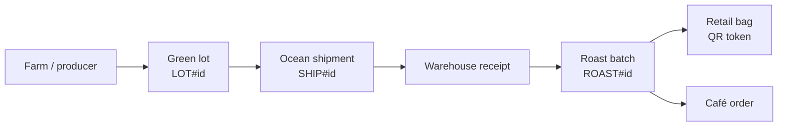

# 04 溯源模組 / Traceability Module

> 需求前綴 Prefix：TRC｜優先階段 Phase：P1
> 相關文件 Related：[03 訂貨](03-module-ordering.md)｜[06 海運追蹤](06-module-shipment-tracking.md)｜[12 資料治理](12-data-governance.md)

---

## 1. 目的 / Purpose

讓消費者掃描豆袋上的 QR Code，看到這包咖啡從農場到烘焙的完整旅程；同時提供內部人員批次層級的追溯查詢，用於品質問題回溯。
Let consumers scan a QR code on the bag to see the full farm-to-roast journey, and let staff trace any roast batch back to its green-coffee lot for quality investigations.

## 2. 範圍 / Scope

| 包含 In scope | 不包含 Out of scope |
|---|---|
| 公開溯源頁、QR 產生、批次鏈結查詢 | 區塊鏈存證 / Blockchain notarization |
| 海運航跡顯示（來自 [06](06-module-shipment-tracking.md)） | 即時船舶地圖 / Live vessel map |

## 3. 追溯鏈 / Traceability Chain

## 4. 功能需求 / Functional Requirements

| 編號 ID | 需求 Requirement | 優先 Priority | 實作服務 Implemented by | 驗證 Verified by |
|---|---|---|---|---|
| TRC-F-001 | 每個烘焙批次產生唯一、不可猜測的 QR token / Unguessable QR token per roast batch | Must | Lambda（128-bit 隨機 random） | 單元測試 |
| TRC-F-002 | 匿名使用者掃碼即可查看溯源頁，無須登入 / Anonymous access | Must | CloudFront、S3、API Gateway | E2E 測試 |
| TRC-F-003 | 溯源頁顯示：產地、生產者、海拔、品種、處理法、杯測分數、烘焙日期 / Show origin and roast details | Must | Lambda、DynamoDB | 合約測試 |
| TRC-F-004 | 顯示海運旅程：出口港、船名、開航與抵達日、航跡摘要 / Show ocean journey | Should | 讀取 SHP 模組資料 | 整合測試 |
| TRC-F-005 | 顯示產區近期天氣摘要並附 Open-Meteo 出處 / Origin weather with attribution | Could | 讀取 PRC 模組資料 | 畫面檢查 UI check |
| TRC-F-006 | 內部人員輸入任一 ID（批次、訂單、船次）可查完整上下游 / Staff bidirectional trace | Must | Lambda、DynamoDB GSI | 整合測試 |
| TRC-F-007 | 支援中英文頁面切換 / zh-TW and en | Should | 前端 Frontend | 畫面檢查 |
| TRC-F-008 | 批次召回標記：被標記的批次溯源頁顯示提醒 / Recall flag banner | Could | DynamoDB 屬性 attribute | E2E 測試 |

## 5. 非功能需求 / Non-Functional Requirements

| 編號 ID | 需求 Requirement | 目標 Target |
|---|---|---|
| TRC-N-001 | 首次載入時間 / First load | < 2 s（4G） |
| TRC-N-002 | 溯源 API 可快取 / Cacheable | CloudFront 快取 5 分鐘 / 5-min TTL |
| TRC-N-003 | 公開頁面不得揭露任何咖啡廳或個資 / No tenant or PII exposure | 欄位白名單 Field allow-list |
| TRC-N-004 | 防列舉：無效 token 回應時間一致，並套用速率限制 / Anti-enumeration | WAF 速率規則 rate rule |
| TRC-N-005 | 每月請求量在 CloudFront Free 方案額度內 / Within Free plan allowance | < 1M requests/month |

## 6. 資料模型 / Data Model

| 實體 Entity | PK | SK | 主要屬性 Key attributes |
|---|---|---|---|
| 生豆批次 Green lot | `LOT#<id>` | `META` | origin, producer, altitude_m, variety, process, cup_score |
| 烘焙批次 Roast batch | `ROAST#<id>` | `META` | lot_id, roast_date, roast_level, qr_token, recall_flag |
| QR 對應 QR lookup | `QR#<token>` | `META` | roast_id |
| 鏈結 Link | `LOT#<id>` | `SHIP#<id>` / `ROAST#<id>` | 關係邊 relationship edge |

| 索引 Index | PK | SK | 用途 Purpose |
|---|---|---|---|
| GSI2 | `ROAST#<id>` | `ORDER#<id>` | 由批次查訂單 / Batch → orders |

## 7. API 端點 / API Endpoints

| 方法 Method | 路徑 Path | 角色 Role | 快取 Cache |
|---|---|---|---|
| GET | `/public/trace/{qr_token}` | 匿名 anonymous | 5 分鐘 |
| GET | `/admin/trace/{entity_type}/{id}` | staff | 不快取 |
| POST | `/admin/roasts/{id}/recall` | staff | — |

## 8. 公開回應欄位白名單 / Public Response Allow-list

`origin_country`、`region`、`producer_display_name`、`altitude_m`、`variety`、`process`、`cup_score`、`roast_date`、`roast_level`、`voyage_summary`、`weather_summary`、`attributions[]`、`recall_notice`

其他欄位一律不輸出，以序列化層白名單實作，而非黑名單。
All other fields are dropped by an allow-list serializer, never a deny-list.

## 9. 使用服務 / Services Used

CloudFront（固定費率 Free 方案）、WAF、S3、API Gateway、Lambda、DynamoDB。

## 10. 驗收條件 / Acceptance Criteria

- [ ] 隨機產生 10,000 個 token 查詢，全部回 404，且不觸發 Lambda 錯誤告警
- [ ] 溯源頁回應中搜尋租戶名稱、Email，結果為 0
- [ ] 同一來源每 5 分鐘超過門檻的請求被 WAF 封鎖
- [ ] 以任一訂單 ID 可追回到農場層級
