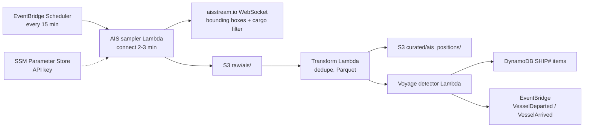
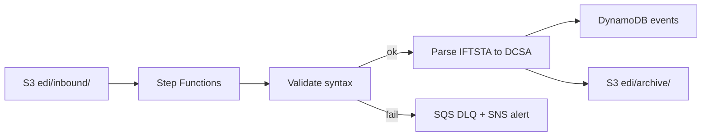

# 06 海運追蹤模組 / Shipment Tracking Module

> 需求前綴 Prefix：SHP｜優先階段 Phase：P2
> 相關文件 Related：[04 溯源](04-module-traceability.md)｜[07 模擬器](07-module-simulator.md)｜[12 資料治理](12-data-governance.md)

---

## 1. 目的 / Purpose

以公開 AIS 資料追蹤從咖啡產地出口港開往台灣的貨櫃船，並以 DCSA Track & Trace 標準格式管理貨櫃事件，提供溯源頁的海運旅程與內部的到港預估。
Track container vessels from coffee-origin ports to Taiwan using public AIS data, manage container events in DCSA Track & Trace format, and feed voyage summaries and ETAs to traceability and staff dashboards.

## 2. 範圍 / Scope

| 包含 In scope | 不包含 Out of scope |
|---|---|
| AIS 取樣收集、航次識別、DCSA 格式事件、UN/EDIFACT IFTSTA 解析 | 真實船公司貨櫃資料 / Real carrier container data |
| 到港時間估算 / ETA estimation | 秒級即時追蹤 / Second-level real-time tracking |
| | 任何非公開的第三方 EDI 格式 / Any non-public third-party EDI mapping |

## 3. 關注港口 / Ports of Interest

| 角色 Role | 港口 Port | UN/LOCODE |
|---|---|---|
| 出口 Origin | Santos（巴西 Brazil） | BRSSZ |
| 出口 Origin | Ho Chi Minh City（越南 Vietnam） | VNSGN |
| 出口 Origin | Mombasa（肯亞 Kenya） | KEMBA |
| 出口 Origin | Djibouti（衣索比亞貨源 Ethiopian cargo） | DJJIB |
| 出口 Origin | Buenaventura（哥倫比亞 Colombia） | COBUN |
| 進口 Destination | Keelung 基隆 | TWKEL |
| 進口 Destination | Kaohsiung 高雄 | TWKHH |

代碼請以 UNECE 最新版 UN/LOCODE 核對。/ Verify codes against the latest UN/LOCODE release.

## 4. 收集流程 / Ingestion Flow

## 5. 功能需求 / Functional Requirements

| 編號 ID | 需求 Requirement | 優先 Priority | 實作服務 Implemented by | 驗證 Verified by |
|---|---|---|---|---|
| SHP-F-001 | 每 15 分鐘取樣 AIS 位置，僅訂閱指定範圍與貨船類型 / Sample AIS every 15 min, filtered | Must | EventBridge Scheduler、Lambda | 執行紀錄 Run log |
| SHP-F-002 | 原始訊息批次寫入 S3 raw zone / Batch write raw messages | Must | Lambda、S3 | 檔案檢查 |
| SHP-F-003 | 依 MMSI 與時間去重並轉為 Parquet / Deduplicate and convert | Must | Lambda | 資料品質檢查 |
| SHP-F-004 | 依船舶與港口地理範圍判斷離港與抵港事件 / Detect departures and arrivals via geofences | Must | Lambda | 歷史資料回放 Replay test |
| SHP-F-005 | 以 DCSA Track & Trace 結構儲存運輸與設備事件 / Store events in DCSA T&T structure | Must | Lambda、DynamoDB | Schema 驗證 |
| SHP-F-006 | 解析 S3 上傳的 UN/EDIFACT IFTSTA 檔，轉為 DCSA 事件 / Parse IFTSTA uploads | Should | S3 事件、Step Functions、Lambda | 樣本檔測試 Sample files |
| SHP-F-007 | 解析失敗的檔案移至 DLQ 並告警 / Failed parses to DLQ with alert | Must | SQS DLQ、SNS | 注入錯誤測試 |
| SHP-F-008 | 依剩餘距離與平均航速估算 ETA / ETA from distance and average speed | Should | Lambda | 與實際抵港比對 Backtest |
| SHP-F-009 | 提供航次摘要給溯源模組 / Provide voyage summary to traceability | Must | DynamoDB | 整合測試 |

## 6. 非功能需求 / Non-Functional Requirements

| 編號 ID | 需求 Requirement | 目標 Target |
|---|---|---|
| SHP-N-001 | 取樣 Lambda 用量落在 Lambda 永久免費額度內 / Within Lambda always-free tier | 約 26 萬 GB-秒/月 / ~260k GB-s/month |
| SHP-N-002 | 不使用 Kinesis Data Streams、MSK、常駐 EC2 / No always-on streaming infra | 架構審查 |
| SHP-N-003 | 位置資料延遲容忍度 / Position latency tolerance | ≤ 20 分鐘 / 20 min |
| SHP-N-004 | EDI 解析冪等：同檔重送不重複產生事件 / Idempotent EDI parsing | 以檔案雜湊去重 / File hash dedupe |
| SHP-N-005 | WebSocket 連線失敗以指數退避重試，最多 3 次 / Exponential backoff, max 3 | 單元測試 |

## 7. 取樣用量估算 / Sampling Usage Estimate

| 參數 Parameter | 值 Value |
|---|---|
| 每日執行次數 Runs/day | 96 |
| 每次執行時間 Duration | 180 秒 s |
| 記憶體 Memory | 512 MB |
| 每月用量 Monthly | 96 × 180 × 0.5 × 30 ≈ 259,200 GB-秒 GB-s |

AWS Lambda 永久免費額度為每月 40 萬 GB-秒（使用前請以官方價格頁確認）。其他 Lambda 也共用此額度，需在 [11 成本治理](11-cost-governance.md) 中追蹤。

## 8. 資料模型 / Data Model

| 實體 Entity | PK | SK | 主要屬性 Key attributes |
|---|---|---|---|
| 航次 Voyage | `SHIP#<voyage_id>` | `META` | mmsi, vessel_name, pol, pod, atd, eta, ata |
| 運輸事件 Transport event | `SHIP#<voyage_id>` | `EVT#<ts>#<id>` | DCSA eventType, transportEventTypeCode, location |
| 設備事件 Equipment event | `CNTR#<container_no>` | `EVT#<ts>#<id>` | DCSA equipmentEventTypeCode, emptyIndicatorCode |
| 航跡摘要 Track summary | `SHIP#<voyage_id>` | `TRACK` | 簡化座標點 simplified points（≤ 200） |

## 9. EDI 處理流程 / EDI Processing

IFTSTA 欄位對應依 UN/EDIFACT 公開目錄自行設計，不沿用任何非公開的第三方對應規則（限制 C-03）。

## 10. 使用服務 / Services Used

EventBridge Scheduler、Lambda、S3、DynamoDB、Step Functions、SQS、SNS、EventBridge、SSM Parameter Store、Glue Data Catalog、Athena。

## 11. 驗收條件 / Acceptance Criteria

- [ ] 連續 7 天收集無中斷，單月 Lambda 用量 < 30 萬 GB-秒
- [ ] 回放 7 天歷史資料，離港與抵港事件判斷準確率 ≥ 90%（人工抽樣比對）
- [ ] 上傳 1 個格式錯誤的 IFTSTA 檔，5 分鐘內收到告警且不影響其他檔案
- [ ] 同一 EDI 檔上傳兩次，事件數不變
