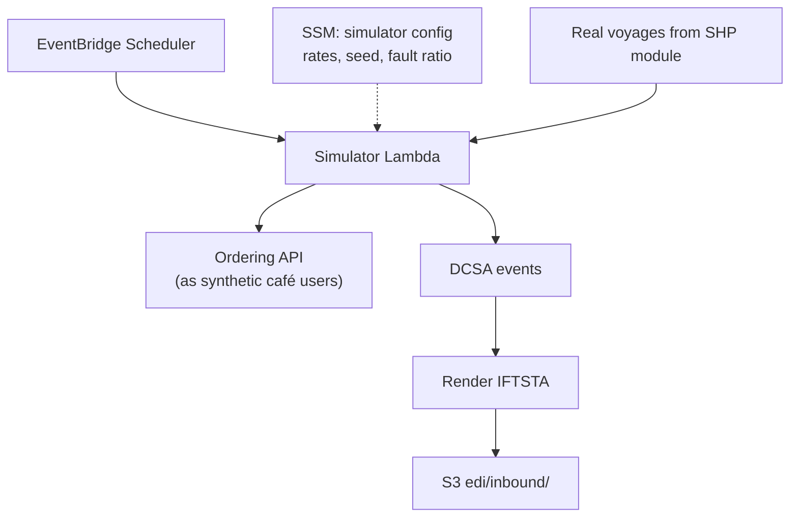

# 07 模擬器模組 / Simulator Module

> 需求前綴 Prefix：SIM｜優先階段 Phase：P1
> 相關文件 Related：[03 訂貨](03-module-ordering.md)｜[06 海運追蹤](06-module-shipment-tracking.md)｜[12 資料治理](12-data-governance.md)

---

## 1. 目的 / Purpose

由於真實的咖啡廳、訂單與貨櫃資料屬私有資料，本模組產生擬真的模擬資料，讓平台在「真實的船、真實的港口與價格、虛構的貨與客戶」下運作，並刻意注入異常以驗證系統韌性。
Because real cafés, orders, and container data are private, this module generates realistic synthetic data so the platform runs on real vessels, ports, and prices with fictional cargo and customers, and it injects faults to test resilience.

## 2. 產生的資料 / Generated Data

| 資料 Data | 頻率 Frequency | 依據 Based on |
|---|---|---|
| 咖啡廳租戶 Café tenants | 初始 30 家，每月新增 1–2 家 / 30 initially, +1–2 monthly | 虛構名稱 Fictional names |
| 生豆批次 Green lots | 每月 3–5 批 / 3–5 per month | CQI 資料集分布 CQI distributions |
| 訂單 Orders | 每日 5–40 筆 / 5–40 per day | 季節性 + 星期效應 Seasonality + weekday |
| 烘焙批次 Roast batches | 依訂單彙總 / From orders | 每批 ≤ 15 kg |
| 貨櫃事件 Container events | 隨真實航次產生 / Following real voyages | AIS 航次 + DCSA 事件序列 |
| IFTSTA 檔案 IFTSTA files | 每個事件一份 / One per event | UN/EDIFACT 公開目錄 |

## 3. 產生流程 / Generation Flow

模擬器透過**公開 API** 下單，而不是直接寫資料庫，使模擬流量走完整的驗證、限流與租戶隔離路徑。
The simulator places orders through the **public API** rather than writing to the database, so synthetic traffic exercises authentication, throttling, and tenant isolation.

## 4. 功能需求 / Functional Requirements

| 編號 ID | 需求 Requirement | 優先 Priority | 實作服務 Implemented by | 驗證 Verified by |
|---|---|---|---|---|
| SIM-F-001 | 產生虛構咖啡廳與聯絡人，姓名與 Email 使用保留網域 `example.com` / Fictional tenants using reserved domain | Must | Lambda | 資料檢查 |
| SIM-F-002 | 依 CQI 分布產生生豆批次屬性，不直接複製原始紀錄 / Sample lot attributes from distributions, never copy records | Must | Lambda | 程式審查 Code review |
| SIM-F-003 | 依季節性模型產生訂單，經由訂貨 API 送出 / Seasonal orders via API | Must | Lambda、API Gateway | 統計檢查 |
| SIM-F-004 | 挑選真實出口港離港的貨櫃船，產生虛構訂艙與貨櫃號 / Attach fictional bookings to real voyages | Must | Lambda、DynamoDB | 整合測試 |
| SIM-F-005 | 貨櫃號符合 ISO 6346 格式與檢查碼 / ISO 6346 container numbers with check digit | Must | Lambda | 單元測試 |
| SIM-F-006 | 依航次進度產生 DCSA 事件序列（gate-in、裝船、離港、抵港、卸船、gate-out）/ DCSA event sequence | Must | Lambda | Schema 驗證 |
| SIM-F-007 | 同步輸出 UN/EDIFACT IFTSTA 檔 / Render IFTSTA files | Should | Lambda、S3 | 解析器回測 Parser round-trip |
| SIM-F-008 | 依設定比例注入異常：重複、順序錯亂、格式錯誤、延遲到達 / Configurable fault injection | Must | Lambda、SSM | 異常偵測率檢查 |
| SIM-F-009 | 支援固定亂數種子以重現情境 / Deterministic seed for reproducibility | Should | Lambda | 重跑比對 Re-run diff |
| SIM-F-010 | 每筆模擬資料標記 `synthetic=true` / Tag all records as synthetic | Must | Lambda | 資料檢查 |

## 5. 異常注入設定 / Fault Injection Profile

| 異常 Fault | 預設比例 Default rate | 預期系統反應 Expected handling |
|---|---|---|
| 重複事件 Duplicate event | 3% | 冪等去重，不產生重複紀錄 |
| 順序錯亂 Out-of-order event | 2% | 依事件時間排序，不覆蓋較新狀態 |
| 格式錯誤 EDI Malformed EDI | 1% | 進入 DLQ 並告警 |
| 延遲到達 Late arrival（> 24h） | 1% | 正確寫入歷史，標記 late |
| 重複下單 Duplicate order request | 2% | Idempotency-Key 擋下 |

## 6. 非功能需求 / Non-Functional Requirements

| 編號 ID | 需求 Requirement | 目標 Target |
|---|---|---|
| SIM-N-001 | 模擬器可透過 SSM 參數一鍵暫停 / Kill switch | 1 分鐘內生效 |
| SIM-N-002 | 模擬流量不得超過 API 限流設定的 50% / ≤ 50% of throttle limits | 監控指標 |
| SIM-N-003 | 模擬器使用的咖啡廳帳號只存在於 Cognito 指定群組 / Dedicated Cognito group | 群組檢查 |
| SIM-N-004 | 不產生任何真實人名、真實公司名 / No real people or companies | 名稱產生器審查 |

## 7. 使用服務 / Services Used

EventBridge Scheduler、Lambda、SSM Parameter Store、API Gateway、Cognito、DynamoDB、S3。

## 8. 驗收條件 / Acceptance Criteria

- [ ] 執行 30 天，每日訂單量分布符合設定的季節性曲線
- [ ] 異常注入後，系統冪等與 DLQ 機制處理率 100%，無資料毀損
- [ ] 同一種子重跑兩次，產生的資料完全相同
- [ ] 將 SSM 開關設為 `paused`，下一輪排程即不產生資料
