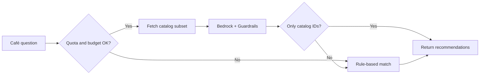

# 08 AI 推薦模組 / AI Recommendation Module

> 需求前綴 Prefix：AIR｜優先階段 Phase：P4（選配 Optional）
> 相關文件 Related：[03 訂貨](03-module-ordering.md)｜[10 資安](10-security.md)｜[11 成本](11-cost-governance.md)

---

## 1. 目的 / Purpose

以 Amazon Bedrock 提供兩項功能：依杯測分數產生風味描述，以及協助咖啡廳以自然語言找到相似的豆子。重點在展示「可控成本、可防護」的生成式 AI 整合，而非模型本身。
Use Amazon Bedrock for tasting-note generation and natural-language bean recommendations. The focus is on demonstrating cost-controlled, guarded generative-AI integration rather than the model itself.

## 2. 功能需求 / Functional Requirements

| 編號 ID | 需求 Requirement | 優先 Priority | 實作服務 Implemented by | 驗證 Verified by |
|---|---|---|---|---|
| AIR-F-001 | 新增生豆批次時，依杯測分數產生中英文風味描述，由內部人員審核後發布 / Generate bilingual tasting notes, human-approved | Should | Bedrock、Lambda、Step Functions | 人工審核紀錄 |
| AIR-F-002 | 咖啡廳以自然語言詢問推薦，系統僅從現有商品目錄中推薦 / Recommend only from current catalog | Could | Bedrock、Lambda、DynamoDB | 測試題庫 Test set |
| AIR-F-003 | 推薦結果附上推薦理由與商品連結 / Explain recommendations with links | Could | Lambda | 畫面檢查 |
| AIR-F-004 | 生成內容快取，同一批次不重複呼叫模型 / Cache generated notes | Must | DynamoDB | 呼叫次數檢查 |
| AIR-F-005 | 失敗或超出預算時退回規則式推薦 / Fallback to rule-based recommendation | Must | Lambda | 故障測試 |

## 3. 非功能需求 / Non-Functional Requirements

| 編號 ID | 需求 Requirement | 目標 Target |
|---|---|---|
| AIR-N-001 | 每月 Bedrock 花費上限 / Monthly Bedrock spend cap | USD 3，超過自動切換規則式 |
| AIR-N-002 | 每租戶每日查詢上限 / Per-tenant daily quota | 20 次 |
| AIR-N-003 | 使用 Bedrock Guardrails 過濾不當內容與提示注入 / Guardrails for harmful content and prompt injection | 紅隊測試題 Red-team prompts |
| AIR-N-004 | 送入模型的內容不含個資 / No PII sent to model | 輸入白名單 Input allow-list |
| AIR-N-005 | 不將 FRED 等有條款限制的資料送入模型 / No restricted-license data to model | 資料來源審查（見 [12](12-data-governance.md)） |
| AIR-N-006 | 選用低成本模型 / Use a low-cost model tier | 使用前查詢最新可用模型與價格 |

## 4. 推薦流程 / Recommendation Flow

輸出驗證步驟確保模型只能回傳目錄中存在的商品 ID，避免幻覺商品。
The validation step ensures only existing catalog IDs are returned, preventing hallucinated products.

## 5. 成本控制機制 / Cost Controls

1. Lambda 每次呼叫後累計 token 用量寫入 DynamoDB 計數器。
2. 計數器換算金額超過上限，即設定 SSM 旗標，後續請求走規則式路徑。
3. 另設 AWS Budgets 以服務篩選 Bedrock 的月預算告警，作為第二道防線。

## 6. 使用服務 / Services Used

Bedrock、Bedrock Guardrails、Lambda、Step Functions、DynamoDB、SSM Parameter Store、AWS Budgets。

## 7. 驗收條件 / Acceptance Criteria

- [ ] 20 題測試問題中，推薦結果 100% 為目錄內商品
- [ ] 10 題提示注入測試，Guardrails 攔截或輸出驗證擋下全部
- [ ] 模擬超出預算後，系統自動切換規則式，使用者仍得到回應
- [ ] 同一批次風味描述只呼叫模型一次
