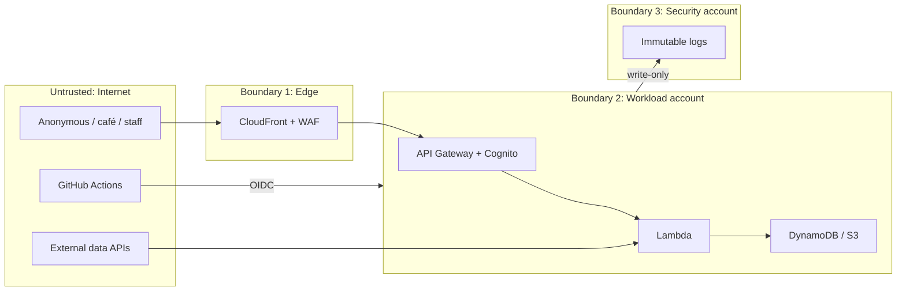
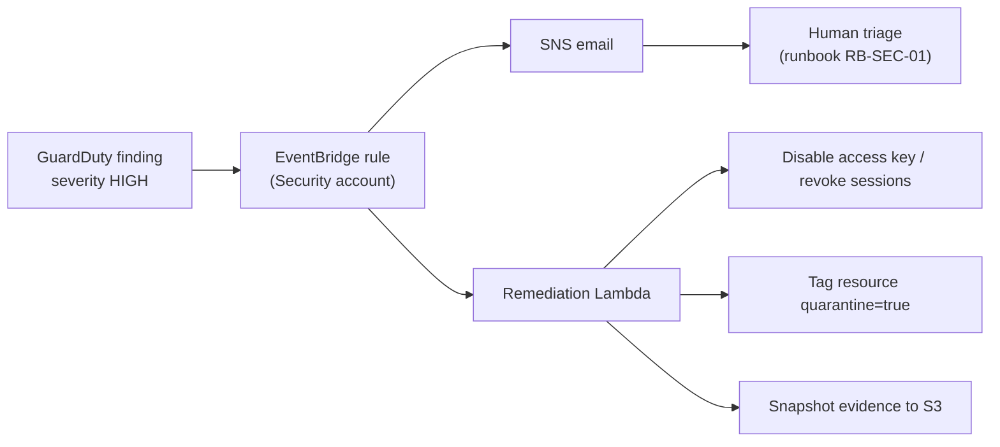

# 10 資安設計 / Security Design

> 相關文件 Related：[01 架構](01-architecture.md)｜[02 部署](02-deployment.md)｜[09 服務配置](09-service-configuration.md)｜[13 維運](13-operations.md)

---

## 1. 安全目標 / Security Objectives

1. 保護咖啡廳聯絡人個資與訂單資料的機密性與完整性。
   Protect confidentiality and integrity of café contact PII and order data.
2. 確保任一帳號被入侵時，稽核日誌仍不可竄改。
   Keep audit logs tamper-proof even if a workload account is compromised.
3. 防止「錢包阻斷」（Denial of Wallet）造成預算失控。
   Prevent Denial-of-Wallet attacks from blowing the budget.
4. 以預防性控制為主、偵測性控制為輔。
   Prefer preventive controls, backed by detective controls.

## 2. 信任邊界 / Trust Boundaries

## 3. 威脅模型 / Threat Model（STRIDE）

| 編號 ID | 類別 Category | 威脅 Threat | 緩解 Mitigation | 控制 Control |
|---|---|---|---|---|
| T-01 | Spoofing | 冒用咖啡廳身分下單 / Impersonate a café | Cognito JWT、staff 強制 MFA | SEC-010 |
| T-02 | Spoofing | 冒用寄件網域發釣魚信 / Spoof sender domain | SPF、DKIM、DMARC | SEC-031 |
| T-03 | Tampering | 竄改他租戶訂單 / Modify other tenant's order | `dynamodb:LeadingKeys` 隔離 | SEC-020 |
| T-04 | Tampering | 竄改稽核日誌 / Tamper with audit logs | 跨帳號封存 + Object Lock | SEC-040 |
| T-05 | Repudiation | 否認管理操作 / Deny admin action | CloudTrail 組織 trail + 日誌檔驗證 | SEC-041 |
| T-06 | Info disclosure | 溯源頁洩漏個資 / PII leak on public page | 回應欄位白名單 | SEC-022 |
| T-07 | Info disclosure | S3 誤設為公開 / Public S3 by mistake | 帳號層級 BPA + SCP 禁止關閉 | SEC-021 |
| T-08 | Info disclosure | API key 外洩 / API key leak | Parameter Store + 不進程式碼 + secret scanning | SEC-032 |
| T-09 | DoS | 流量灌爆 API / Flood API | WAF 速率規則、API 限流、Lambda 保留併發 | SEC-050 |
| T-10 | Denial of Wallet | 大量請求或 AI 呼叫拉高帳單 / Cost exhaustion | 固定費率 CDN、限流、Bedrock 配額、Budget Actions | SEC-051 |
| T-11 | Elevation | CI 管線被濫用取得高權限 / Pipeline privilege abuse | OIDC 限定 repo 與分支、Landing Zone 不進 CI | SEC-012 |
| T-12 | Elevation | 提示注入讓 AI 洩漏資料 / Prompt injection | Guardrails、輸出驗證、不送個資 | SEC-033 |
| T-13 | Tampering | 供應鏈：惡意相依套件 / Malicious dependency | Dependabot、鎖定版本、CI 掃描 | SEC-060 |

## 4. 控制措施 / Controls

### 4.1 身分與存取 / Identity & Access

| 編號 ID | 控制 Control |
|---|---|
| SEC-010 | 人員一律透過 IAM Identity Center 登入並強制 MFA；不建立 IAM User |
| SEC-011 | 成員帳號移除 root 憑證，由 Management 帳號集中管理 root 存取 |
| SEC-012 | GitHub Actions 以 OIDC 取得臨時憑證，信任條件限定 repo、分支或 environment |
| SEC-013 | 每個 Lambda 獨立 IAM 角色，權限以 cdk-nag 檢查萬用字元 |
| SEC-014 | IAM Access Analyzer 組織層級分析器，每週檢視外部存取發現 |

### 4.2 組織防護欄 / Organization Guardrails（SCP / RCP）

| 政策 Policy | 內容 Content | 目的 Purpose |
|---|---|---|
| `scp-region-restrict` | 拒絕 ap-northeast-1、us-east-1 以外區域；`env=drill` 標籤例外允許 ap-southeast-1 | 資安 + 成本 |
| `scp-protect-security-services` | 拒絕停用 CloudTrail、GuardDuty、Security Hub、Config | 資安 |
| `scp-deny-leave-org` | 拒絕 `organizations:LeaveOrganization` | 資安 |
| `scp-deny-root` | 拒絕成員帳號 root 使用者的所有動作 | 資安 |
| `scp-deny-expensive` | 拒絕 NAT Gateway、EKS、SageMaker 端點、大型 EC2 機型、Redshift、OpenSearch | 成本 |
| `scp-protect-s3-bpa` | 拒絕修改 S3 Block Public Access 設定 | 資安 |
| `scp-budget-lockdown` | 拒絕新建資源（`cloudformation:CreateStack/UpdateStack`、`lambda:CreateFunction`、`ec2:RunInstances`、`s3:CreateBucket` 等）與高成本呼叫（`bedrock:InvokeModel`、`athena:StartQueryExecution`）；僅由 Budget Actions 掛載。刻意不用 `Create*`、`Put*` 萬用字元，以免擋住 Lambda 寫日誌等正常執行 | 成本 |
| `rcp-data-perimeter` | S3 與 KMS 僅允許組織內身分存取（AWS 服務主體例外） | 資安 |

區域限制 SCP 必須以 `NotAction` 排除全域服務（IAM、Organizations、CloudFront、Route 53、Budgets、Support 等），否則會擋住正常操作；部署前先在 Dev OU 試套用。
The region SCP must exempt global services via `NotAction`; trial it on the Dev OU first.

`scp-budget-lockdown` 需排除部署角色的刪除動作與 Identity Center 管理員角色，確保超支時仍能清理資源。
`scp-budget-lockdown` must still allow deletions and the admin role so resources can be cleaned up.

### 4.3 資料保護 / Data Protection

| 編號 ID | 控制 Control |
|---|---|
| SEC-020 | 租戶隔離以 IAM 條件於資料層強制（見 [03](03-module-ordering.md)） |
| SEC-021 | S3 帳號層級封鎖公開存取，網站僅透過 CloudFront OAC 存取 |
| SEC-022 | 公開 API 以欄位白名單序列化 |
| SEC-023 | 靜態加密：DynamoDB、S3、SQS、SNS、Logs 使用 KMS；傳輸加密：TLS 1.2+ |
| SEC-024 | 資料分級標籤 `data-class`，`pii` 資源另受 Config 規則檢查加密 |

### 4.4 應用程式 / Application

| 編號 ID | 控制 Control |
|---|---|
| SEC-030 | 所有輸入以 JSON Schema 驗證；EDI 解析在獨立 Lambda 執行 |
| SEC-031 | SES 網域設定 SPF、DKIM、DMARC |
| SEC-032 | 第三方 API key 存於 SSM SecureString；GitHub 開啟 secret scanning 與 push protection |
| SEC-033 | Bedrock 使用 Guardrails，輸出僅接受目錄內 ID |

### 4.5 稽核與偵測 / Logging & Detection

| 編號 ID | 控制 Control |
|---|---|
| SEC-040 | CloudTrail 寫入 Security 帳號 S3，Object Lock Governance 模式 1 年 |
| SEC-041 | 開啟 CloudTrail 日誌檔完整性驗證 |
| SEC-042 | GuardDuty 由 Security 帳號委派管理，涵蓋所有帳號 |
| SEC-043 | Security Hub FSBP 標準，Prod 合規分數 ≥ 90% |
| SEC-044 | AWS Config 範圍化記錄，搭配必要的託管規則 |

### 4.6 可用性與成本攻擊 / Availability & Cost Attacks

| 編號 ID | 控制 Control |
|---|---|
| SEC-050 | WAF 速率規則、API Gateway 限流、Lambda 保留併發 |
| SEC-051 | CloudFront 固定費率方案無超額費用；Budget Actions 自動鎖定 |

### 4.7 供應鏈 / Supply Chain

| 編號 ID | 控制 Control |
|---|---|
| SEC-060 | 相依套件鎖定版本，Dependabot 每週檢查 |
| SEC-061 | CI 執行 cdk-nag、checkov，High 等級阻擋合併 |
| SEC-062 | main 分支保護：需 PR、需 CI 通過、禁止強制推送 |

## 5. 事件回應 / Incident Response

| 嚴重度 Severity | 自動處置 Automated | 人工回應時間 Human response |
|---|---|---|
| High | 是 Yes | 24 小時內 within 24 h |
| Medium | 否 No，僅通知 | 72 小時內 within 72 h |
| Low | 否 No | 每週檢視 Weekly review |

詳細步驟見 [13 維運手冊](13-operations.md) RB-SEC-01。

## 6. 安全測試 / Security Testing

| 測試 Test | 頻率 Frequency | 方法 Method |
|---|---|---|
| IaC 靜態掃描 IaC scanning | 每個 PR | cdk-nag、checkov |
| 相依套件掃描 Dependency scan | 每週 | Dependabot |
| 租戶隔離測試 Tenant isolation | 每次部署 | 整合測試 |
| 金鑰外洩演練 Key leak drill | 每季 | 刻意觸發 GuardDuty 範例發現 / Generate sample findings |
| 提示注入測試 Prompt injection | AI 模組變更時 | 紅隊題庫 |
