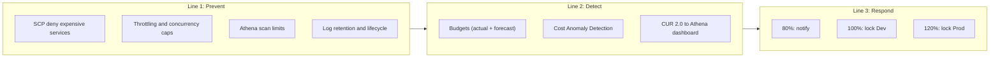

# 11 成本治理 / Cost Governance

> 相關文件 Related：[01 架構](01-architecture.md)｜[10 資安](10-security.md)｜[13 維運](13-operations.md)

---

## 1. 預算目標 / Budget Targets

| 項目 Item | 金額 Amount |
|---|---|
| 年度上限 Annual cap | USD 300 |
| 基線年度預估 Baseline annual estimate | USD 150–240 |
| 演練與緩衝 Drills & buffer | USD 60–150 |
| 月度預算 Monthly budget（全組織 org-wide） | USD 25 |

## 2. 年度成本估算 / Annual Cost Estimate

| 類別 Category | 項目 Items | 估算 Estimate (USD/yr) |
|---|---|---|
| 網域與 DNS Domain & DNS | 網域註冊 / Domain registration | 15–20 |
| 邊緣 Edge | CloudFront + WAF + DDoS（固定費率 Free 方案） | 0 |
| 應用 Application | Lambda、API Gateway、DynamoDB、Step Functions、EventBridge、SES | 20–40 |
| 資料 Data | S3、Athena、Firehose、Glue Catalog | 15–30 |
| 收集 Ingestion | AIS 取樣、外部 API 排程、模擬器 | 0–10 |
| 偵測與合規 Detection & compliance | GuardDuty、Security Hub、Config | 50–90 |
| 稽核與加密 Audit & encryption | CloudTrail 儲存、KMS（2 把 CMK） | 20–30 |
| 備份 Backup | DynamoDB PITR | 1–5 |
| 可觀測性 Observability | CloudWatch Logs、X-Ray、告警 | 5–15 |
| AI（選配 optional） | Bedrock | 0–36 |
| 成本工具 Cost tools | Budgets、Anomaly Detection、Data Exports | 0–5 |
| **合計 Total** | | **約 126–281** |

偵測與合規服務的估算最不確定，必須在 30 天試用期內實測，再依 [§7](#7-試用期決策點--trial-period-decision-point) 調整範圍。
Detection/compliance estimates are the least certain and must be measured during the 30-day trials.

## 3. 三道防線 / Three Lines of Defense

### 3.1 第一道：預防 / Line 1: Prevent

| 編號 ID | 控制 Control | 實作 Implementation |
|---|---|---|
| COST-001 | 禁止高成本服務 / Deny expensive services | SCP `scp-deny-expensive`（見 [10](10-security.md)） |
| COST-002 | 限制區域 / Restrict regions | SCP `scp-region-restrict` |
| COST-003 | API 限流 / API throttling | API Gateway 預設與路由限流 |
| COST-004 | Lambda 保留併發上限 / Concurrency caps | 每個函數設定 reserved concurrency |
| COST-005 | DynamoDB 最大吞吐量 / Max throughput | On-demand max read/write |
| COST-006 | Athena 掃描上限 / Scan cap | Workgroup 單次 1 GB |
| COST-007 | 日誌保留 / Log retention | Prod 30 天、Dev 7 天，禁止「永不過期」 |
| COST-008 | S3 生命週期 / Lifecycle | raw 90 天轉 Glacier IR、2 年刪除 |
| COST-009 | 演練資源自動清除 / Drill TTL cleanup | `ttl` 標籤 + 每小時清除 Lambda |
| COST-010 | Bedrock 配額 / Bedrock quota | 應用層計數器 + SSM 旗標（見 [08](08-module-ai-recommendation.md)） |
| COST-011 | 架構避開常駐計費 / Avoid always-on charges | 無 NAT、無 ALB、無常駐 EC2、Lambda 不放 VPC |

### 3.2 第二道：偵測 / Line 2: Detect

| 編號 ID | 控制 Control | 設定 Configuration |
|---|---|---|
| COST-020 | 組織月預算 / Org monthly budget | USD 25；實際 50%、80%、100%；預測 100% |
| COST-021 | 每帳號月預算 / Per-account budgets | Prod USD 15、Dev USD 5、Security USD 5 |
| COST-022 | 服務別預算 / Per-service budgets | Bedrock USD 3、GuardDuty + Security Hub + Config 合計 USD 8 |
| COST-023 | 成本異常偵測 / Anomaly detection | 服務別監控，單日異常 > USD 2 通知 |
| COST-024 | 成本分配標籤 / Cost allocation tags | 啟用 `project`、`env`、`module` |
| COST-025 | CUR 2.0 匯出 / Data Exports | 匯出至 Management 帳號 S3，以 Athena 查詢 |

### 3.3 第三道：自動回應 / Line 3: Respond（Budget Actions）

| 門檻 Threshold | 動作 Action | 範圍 Scope | 核准 Approval |
|---|---|---|---|
| 80%（實際 actual） | SNS 通知 / Notify | 全組織 | 自動 Auto |
| 100%（預測 forecast） | 通知 + 模擬器暫停（SSM 旗標）/ Pause simulator | Prod | 自動 Auto |
| 100%（實際 actual） | 掛載 `scp-budget-lockdown` | Workload-Dev | 自動 Auto |
| 120%（實際 actual） | 掛載 `scp-budget-lockdown` | Workload-Prod | 手動核准 Manual |

只使用 2 個啟用動作的預算（組織預算、Prod 預算），維持在免費範圍內。IAM / SCP 類動作會在下個預算週期自動解除。
Only two action-enabled budgets are used to stay within the free allowance. IAM/SCP actions reset at the next budget period.

## 4. 成本儀表板 / Cost Dashboard

以 CUR 2.0 資料建立 Athena 視圖，呈現於內部儀表板：

| 視圖 View | 內容 Content |
|---|---|
| `cost_by_service_month` | 每月各服務成本 |
| `cost_by_module_month` | 依 `module` 標籤分攤 |
| `cost_by_env_month` | Dev 與 Prod 比較 |
| `free_tier_burn` | Lambda GB-秒、DynamoDB 請求數相對永久免費額度 |
| `cost_per_order` | 單位經濟：每筆訂單平均基礎設施成本 / Unit cost per order |

`cost_per_order` 是面試時展示 FinOps 思維的關鍵指標。

## 5. 月度檢視 / Monthly Review

每月 5 日前完成，紀錄於 `docs/cost-reviews/YYYY-MM.md`：

- [ ] 本月實際 vs 預算、累計 vs 年度上限
- [ ] 前 5 大成本服務與變化原因
- [ ] 異常偵測事件與處理
- [ ] 免費額度使用率
- [ ] 下月預計演練與預算
- [ ] 是否需要調整安全服務範圍

## 6. 演練預算 / Drill Budget

| 演練 Drill | 頻率 Frequency | 預估 Estimate |
|---|---|---|
| DR 跨區重建 / Cross-region rebuild | 每半年 Twice a year | USD 5–15 / 次 |
| 負載測試 Load test | 每季 Quarterly | USD 2–10 / 次 |
| 安全事件演練 Security drill | 每季 Quarterly | 約 0 |

## 7. 試用期決策點 / Trial Period Decision Point

GuardDuty 與 Security Hub 試用期結束前 5 天：

1. 以 Security Hub 成本估算器比較個別計價與統一計價。
2. 若推估年費超過 USD 90，依序縮減：Dev 關閉 Security Hub → Config 改為每日記錄 → GuardDuty 關閉 S3 Protection。
3. 決策寫入 [ADR-008](14-adr-and-risks.md)。
