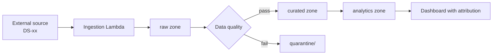

# 12 資料治理 / Data Governance

> 相關文件 Related：[05 採購分析](05-module-procurement-analytics.md)｜[06 海運追蹤](06-module-shipment-tracking.md)｜[07 模擬器](07-module-simulator.md)｜[10 資安](10-security.md)

---

## 1. 外部資料來源與授權 / External Sources & Licenses

| 編號 ID | 來源 Source | 取得方式 Access | 授權重點 License terms | 出處標示 Attribution | 查證 Verified |
|---|---|---|---|---|---|
| DS-01 | aisstream.io | WebSocket，免費 API key | 非商業用途（依第三方說明，需讀官方條款）/ Non-commercial (confirm official terms) | 依官方條款 | 部分 Partial |
| DS-02 | FRED（IMF 咖啡價格）| CSV 免 key；API 需 key | 個人、教育、非商業；第三方著作權系列需另行授權；含 AI 相關使用限制，需讀全文 | 標示 FRED 與原始來源 | 是 Yes |
| DS-03 | Open-Meteo | REST，免 key | 非商業、CC BY 4.0；每日 < 10,000 次 | 「Weather data by Open-Meteo.com」附連結 | 是 Yes |
| DS-04 | ECB 參考匯率 | XML / CSV / SDMX，免 key | 可再利用含商業用途；不可修改 | 「Source: ECB statistics.」 | 是 Yes |
| DS-05 | 央行新台幣匯率 CBC TWD rate | data.gov.tw | 待確認資料集與授權 | 待確認 | 否 No |
| DS-06 | 關務署進出口統計 | data.gov.tw CSV、OpenAPI | 政府資料開放授權條款第 1 版 | 依授權條款標示 | 是 Yes |
| DS-07 | CQI 杯測資料集 | GitHub / Kaggle | 程式 MIT；原始資料著作權屬 CQI，僅作分布參考 | README 註明 | 是 Yes（灰色地帶） |
| DS-08 | DCSA 標準 | 官網、SwaggerHub | 開放標準 | 文件註明 | 是 Yes |
| DS-09 | UN/LOCODE | UNECE 官網 | 待確認 | 待確認 | 否 No |
| DS-10 | World Port Index | NGA 官網 | 待確認 | 待確認 | 否 No |

**使用規則 Usage rules**

| 編號 ID | 規則 Rule |
|---|---|
| DATA-001 | 標示「待確認」的來源，確認授權前不得上線 Prod / Unverified sources stay out of Prod |
| DATA-002 | 原始外部資料不提供對外下載，只呈現計算結果 / No raw redistribution |
| DATA-003 | DS-02（FRED）資料不送入 Bedrock / FRED data never sent to Bedrock |
| DATA-004 | DS-07（CQI）只用於統計分布，不複製個別紀錄 / Distributions only |
| DATA-005 | 前端設「資料來源」頁集中列出所有出處 / Central attribution page |
| DATA-006 | 若專案商業化，DS-01、DS-02、DS-03 須改為付費方案或替換 / Replace on commercialization |

## 2. 資料分級 / Data Classification

| 等級 Class | 定義 Definition | 範例 Examples | 控制 Controls |
|---|---|---|---|
| `public` | 可公開顯示 / Publicly displayable | 溯源頁欄位、商品目錄 | 白名單輸出 |
| `internal` | 僅內部使用 / Internal only | 訂單、庫存、資料湖、成本資料 | KMS 加密、IAM 限制 |
| `pii` | 可識別個人 / Personally identifiable | 咖啡廳聯絡人姓名、Email、電話、地址 | CMK 加密、最小化、存取稽核、Macie 一次性掃描 |

即使所有個資都是模擬產生，仍依真實個資標準處理，以展示合規設計。
Even though all PII is synthetic, it is handled as real PII to demonstrate compliant design.

## 3. 資料保留 / Retention

| 資料 Data | 位置 Location | 保留 Retention | 機制 Mechanism |
|---|---|---|---|
| 訂單 Orders | DynamoDB | 帳號存續 + 2 年 | 帳號關閉時設定 TTL |
| 冪等紀錄 Idempotency records | DynamoDB | 24 小時 | TTL |
| 聯絡人 Contacts | DynamoDB | 帳號存續期間 | 刪除請求流程 |
| raw zone | S3 | 2 年（90 天後轉 Glacier IR） | Lifecycle |
| curated / analytics | S3 | 2 年 | Lifecycle |
| Athena 查詢結果 Query results | S3 | 7 天 | Lifecycle |
| 應用日誌 App logs | CloudWatch Logs | 30 天（Prod） | Retention policy |
| 稽核日誌 Audit logs | Security 帳號 S3 | 1 年，Object Lock | Lifecycle + Lock |
| EDI 封存 EDI archive | S3 | 1 年 | Lifecycle |

## 4. 個資處理 / PII Handling

| 編號 ID | 要求 Requirement |
|---|---|
| DATA-010 | 只收集訂貨必要欄位 / Collect only necessary fields |
| DATA-011 | 個資欄位不寫入日誌，Powertools Logger 設定遮罩 / Mask PII in logs |
| DATA-012 | 個資不進入資料湖；事件中以 `tenant_id` 代替 / No PII in data lake |
| DATA-013 | 提供刪除請求流程：刪除聯絡人、匿名化歷史訂單 / Deletion with order anonymization |
| DATA-014 | 個資不送入 Bedrock / No PII to Bedrock |

## 5. 資料血緣 / Data Lineage

每張 Glue 表格的 table properties 必須包含：

| 屬性 Property | 範例 Example |
|---|---|
| `source_id` | `DS-03` |
| `source_url` | 官方網址 / Official URL |
| `license` | `CC-BY-4.0, non-commercial` |
| `attribution_text` | `Weather data by Open-Meteo.com` |
| `ingested_by` | `brewline-prod-procurement-weather-ingest` |
| `synthetic` | `false` |

模擬資料的表格標記 `synthetic=true`，避免與真實外部資料混淆。

## 6. 資料品質規則 / Data Quality Rules

| 檢查 Check | 適用 Applies to | 失敗處理 On failure |
|---|---|---|
| 必要欄位非空 / Required fields not null | 全部 All | 隔離 Quarantine |
| 數值範圍 / Value range（例：咖啡價格 10–1,000 美分/磅） | 價格、天氣、匯率 | 隔離 + 告警 |
| 重複鍵 / Duplicate keys | 全部 | 去重 Dedupe |
| 時間新鮮度 / Freshness（超過預期週期 2 倍未更新） | 排程來源 | 告警 Alert |
| Schema 變更 / Schema drift | 外部 API | 隔離 + 告警 |
